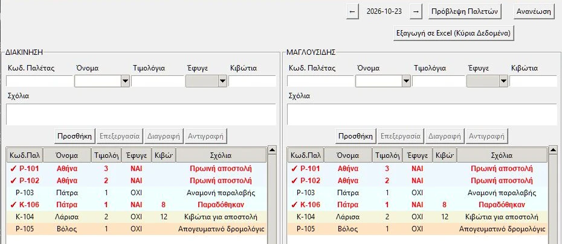
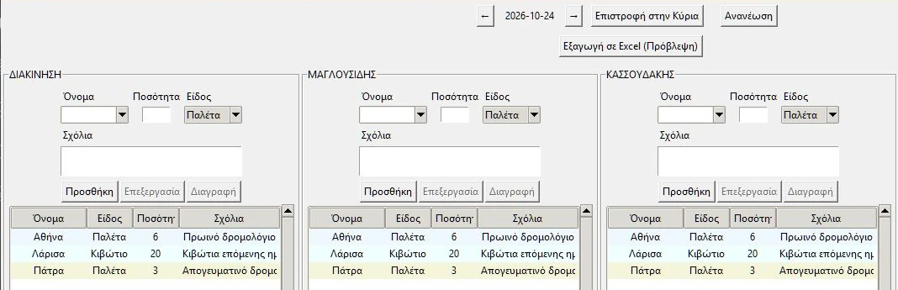
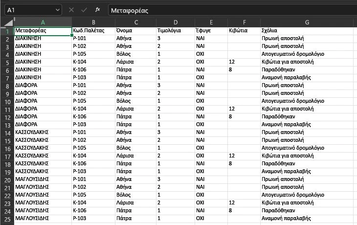

# Paletes Manager

[](https://github.com/alexneverland/paletes-manager/actions/workflows/tests.yml)
[](LICENSE)

A desktop application for tracking pallets and boxes by carrier, with daily history, shipment planning and Excel export. Built for everyday use in warehouses, transport offices and logistics.

The application interface is currently in Greek.

[View the project presentation](https://lazaros-solutions.vercel.app/#paletes-presentation).

## Features

- Record pallets and boxes by carrier.
- Toggle departure status with a double-click.
- Browse daily records and shipment history.
- Plan pallet and box requirements for upcoming days.
- Automatically calculate pallet, box and invoice totals.
- Identify related records through color grouping.
- Export data to Excel.
- Store data locally in SQLite.
- Work offline without a server.

## Screenshots

These are real screenshots of the application and its exported Excel file, captured with a separate demo database. No office database or customer records were used.

### Daily tracking and departures

Pallets and boxes grouped by carrier, with a clear view of departed and pending shipments.



### Planning upcoming days

Prepare pallet and box quantities, destinations and route notes before the shipment date.



### Excel export

Export the selected day's records for further processing and sharing.



## Technology

- Python
- Tkinter
- SQLite
- Pandas
- openpyxl for Excel export

## Using the portable Windows EXE

The EXE runs directly without installing Python. The database stays at
`data/paletes.db` beside the executable. Updating the EXE does not change this
path. On first use, the data directory is created automatically.

### Updating an office setup with a shared database on two computers

1. Close the application on both computers.
2. Back up the entire existing `data` directory.
3. Replace only the EXE in its existing location. If you have two copies of the
   program, update both. Preserve the existing connection to the shared database;
   do not create two independent data directories.
4. Start the new version on one computer first. The database switches from WAL
   to rollback journaling (`DELETE`), without changing tables or records. Once
   startup is complete, open the application on the second computer.
5. Do not run the old and new versions together: the old version enables WAL.

WAL does not support access to the same database from different computers over
a network; see the [SQLite WAL documentation](https://sqlite.org/wal.html).
Rollback journaling requires reliable file locking on the shared network folder.
Testing two local connections does not replace testing the actual office network.

There is no conflict detection when two users edit the same record or prediction:
the last save wins. Avoid editing the same record simultaneously on two computers.

Daily backups use the SQLite backup API and are published only after completion.
Up to 14 daily backups are retained. The existing policy deletes history older
than 40 days; if the startup backup fails, cleanup is skipped and a message is
displayed.

While a record is being edited, refresh is deferred to preserve unsaved changes.
Normal refresh resumes after saving or cancelling. Explicit column sorting takes
precedence over the default grouping by name.

## Running from source

Requires Python 3.9 or later with Tkinter.

```powershell
python -m venv .venv
.venv/Scripts/python.exe -m pip install -r requirements.txt
.venv/Scripts/python.exe main.py
```

## Testing and building the Windows EXE

```powershell
.venv/Scripts/python.exe -m pip install -r requirements-dev.txt
.venv/Scripts/python.exe -m pytest -q --basetemp=.pytest_tmp
.venv/Scripts/python.exe -m PyInstaller --noconfirm --clean --onefile --windowed --name PaletesManager --hidden-import openpyxl main.py
```

The new executable is created at `dist/PaletesManager.exe`. It does not include
the database. Tests use temporary databases and real Tkinter widgets in a hidden
window, without accessing office data.

## Data

When running the EXE, the database is located at `data/paletes.db` beside the
executable. When running from source, it is located at `paletes/data/paletes.db`.
The database, backups and exported Excel files are not included in this repository.

## License and support

The source code is available under the [MIT License](LICENSE). Use, modification
and commercial use are permitted under its terms, provided the copyright notice
and license text are retained in copies. The software is provided as is, without
warranty, as stated in the license.

For customization to fit your business processes or professional support,
[contact Lazaros Solutions](https://lazaros-solutions.vercel.app/#contact).
Customization and support can be arranged as separate services.

## Purpose

This project was built as a practical working tool for everyday operations.
It can be used as is or serve as a foundation for future extensions, modular
refactoring or a commercial edition.

## Customization and future upgrades

The current version supports local office operation with SQLite. Depending on
requirements, it could be extended with additional features, more users, access
controls or a centralized external PostgreSQL database, for example through
Supabase. Such an upgrade requires appropriate access design, data migration and
handling of concurrent changes; it is not an existing feature of this version.
